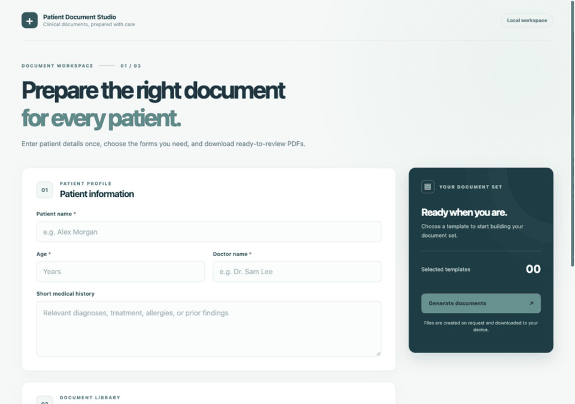

# Patient Document Studio

A local MVP for a doctor to register patients once, create lab and genetic test orders, and print completed request forms. Each patient gets a stable code such as `P-000001`. Several tests can share one request form; selecting them produces one filled form per laboratory and form type, with the requested number of copies. A patient summary PDF lists everyone in the registry.

## Workflow preview



The preview uses fictitious patient data.

## Run locally

```bash
python3 -m venv .venv
source .venv/bin/activate
pip install -e '.[dev]'
uvicorn app.main:app --host 127.0.0.1 --port 8000 --reload
```

Open [http://127.0.0.1:8000](http://127.0.0.1:8000). The older one-off template form is available at `/quick`.

## Everyday use

1. Add a patient with name, age, and brief medical history. The app assigns a code and stores the record in local SQLite.
2. Select **Add order** beside the patient, tick tests under their laboratories, enter the doctor and optional clinical question, and choose copies per form.
3. Save the order. A printable PDF downloads for one form, or a ZIP of PDFs for multiple forms or copies. The order remains on the patient for later downloads.
4. Use **Patient summary** for a PDF of the current registry. Use **Clean up** to preview and delete patients older than a chosen number of days, along with their orders. Individual patients and orders can also be deleted.

## Configure forms and tests

- Edit [`catalog/labs.json`](catalog/labs.json) to add laboratories and tests. Every test references a `template_id`; many tests may share one form.
- Edit the JSON fallback forms in [`templates/`](templates/) or put approved fillable PDF forms in [`form_assets/`](form_assets/) with mappings in `manifest.json`. A mapped PDF takes precedence over the JSON form.
- `TEMPLATE_DIR`, `FORM_ASSET_DIR`, and `DATABASE_PATH` override the local directories and SQLite path. The default database is `data/patients.sqlite3` and is excluded from Git.
- The `TemplateSource` and `FormAssetSource` interfaces allow another source, such as an API or Google Docs export pipeline, to replace local files later. See [architecture](docs/architecture.md), [catalog authoring](docs/catalog-authoring.md), and [form assets](form_assets/README.md).

Word can be used to design a form, then exported as a fillable PDF for the local printing workflow. The app fills PDF AcroForm text fields; the original form remains fillable.

## Test

```bash
pytest -q
```

This is a local evaluation build. It has no login, access control, audit trail, encryption at rest, or clinical template approval workflow. Use fictitious data until those controls and the clinic's retention policy are in place.
